<p align="center">
  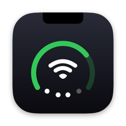
</p>

<h1 align="center">BetterNotch</h1>

<p align="center">
  A native macOS app that turns the MacBook notch into a status bar, an agent console and a scratch space.
</p>

<p align="center">
  
  
  
</p>

BetterNotch is a fork of [Notchly](https://github.com/Notchly/Notchly) (MIT), renamed and maintained by Max Hunt. If you are coming from Notchly, the first launch copies your settings, usage keys and agent hooks across.

## At a glance

<p align="center">
  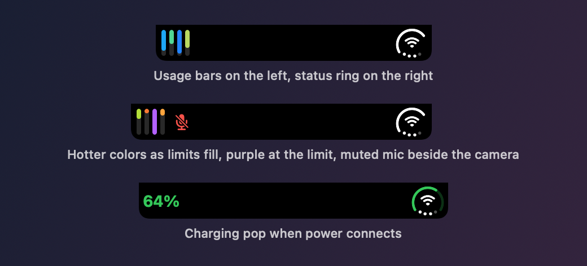
</p>

The closed notch stays out of the way. The camera sits in the middle, with a small wing on each side:

- **Right wing, the status ring.** One glyph shows three things. The outer arc is your battery level. The center shows your network: Wi-Fi bars, an Ethernet plug, or offline. The four dots along the bottom show output volume.
- **Left wing, usage bars.** One short bar for each subscription limit: Claude's 5-hour, weekly and per-model limits, plus Codex's weekly limit and, on plans that have one, its 5-hour limit. The colored part is what's left, so a fresh limit is a full bar, and it shrinks and warms in color as you use it. They refresh every 5 minutes. **Settings → AI Usage** switches between two bar styles.
- **Muted mic.** A red slashed mic appears next to the camera whenever your microphone is muted.

Each glyph sits as far from the camera as from the notch's edge. If yours sits too close to the camera or too far from it, **Settings → General → Space Beside Camera** moves both sides in or out, with a Reset button to go back to the default.

<p align="center">
  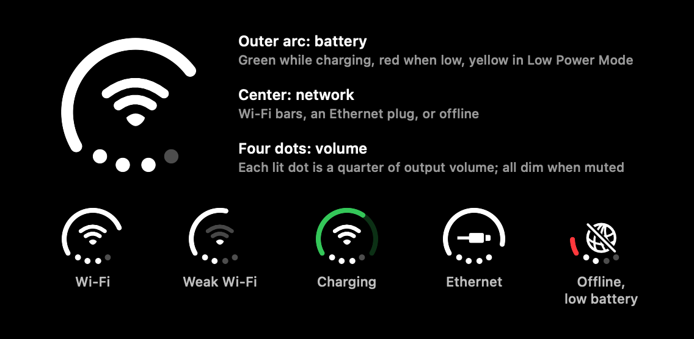
</p>

Charging color changes the moment you plug in or unplug. On power at 100%, the arc turns into fine green ticks. When macOS holds the charge below 100% to protect the battery, the ring shows it; **Settings → Battery** picks one of four styles (a calm teal arc by default, a limit marker, ticks for the rest, or a hollow arc).

Turning the battery off in settings hides only the ring; the usage bars, muted mic and tabs stay.

While music plays, the album artwork takes the left wing, spaced like the usage bars, and the status ring stays on the right. Meeting countdowns and the brightness, volume, Focus and network notices also use wings only as wide as what they show.

<p align="center">
  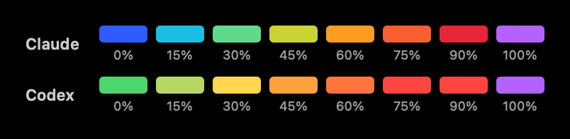
</p>

Colors follow how much is used. Claude's run cold to hot, from blue through cyan, green and amber to red. Codex's run green to red. Any bar at its limit is solid purple.

<p align="center">
  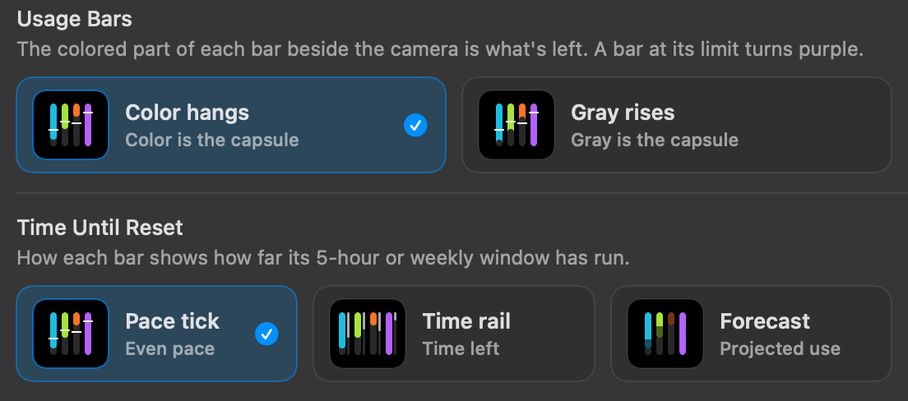
</p>

Pick how the bars are drawn in **Settings → AI Usage**: what's left as a colored capsule hanging from the top (the default), or what's used as a gray capsule rising from the bottom. The same page chooses which limits get a bar beside the camera (5-hour, weekly, Fable weekly, Codex 5-hour, Codex weekly); the Usage tab always shows them all.

## Opened notch

Click the notch, or just hover over it, to open it.

<p align="center">
  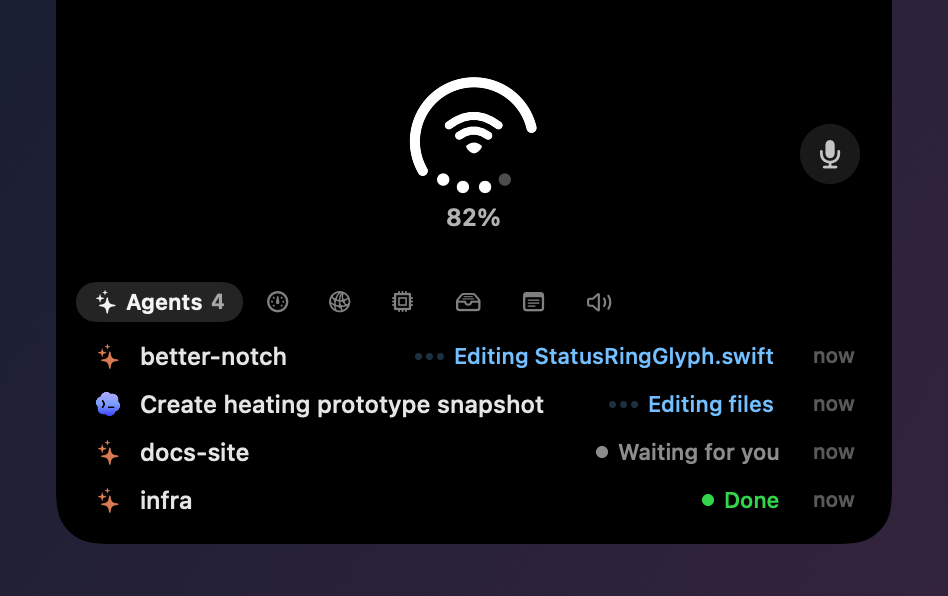
</p>

The top shows a large status ring with the battery percentage, plus a mic mute button. Below it is a row of tabs. Swipe or click to switch tabs, and the notch resizes to fit each one.

<table>
  <tr>
    <td>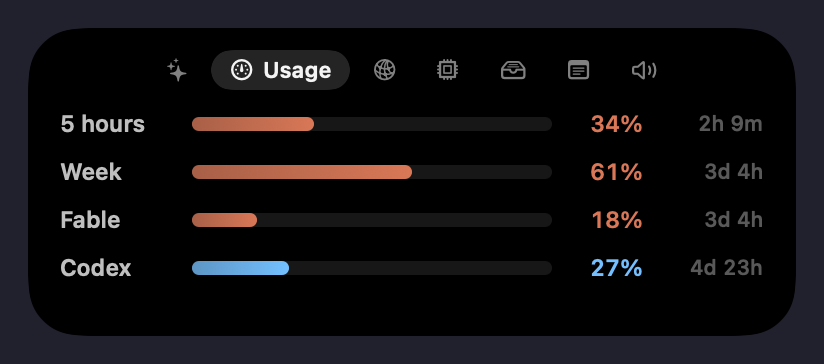</td>
    <td>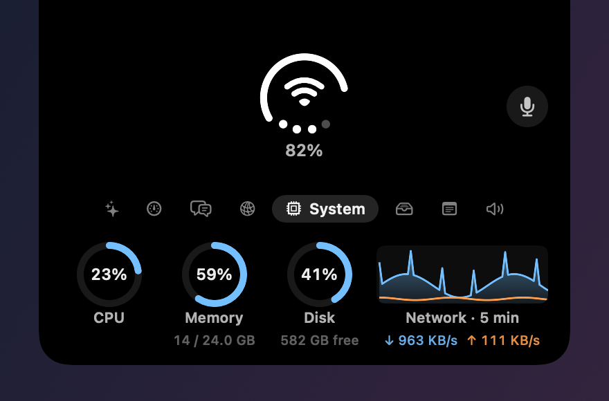</td>
  </tr>
  <tr>
    <td>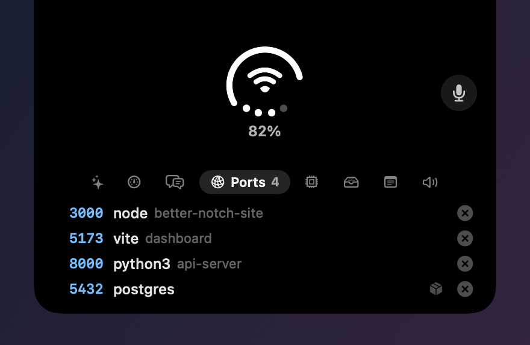</td>
    <td>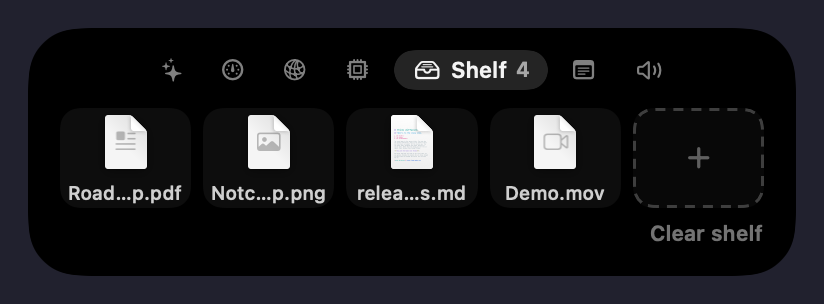</td>
  </tr>
</table>

| Tab | What it shows |
|---|---|
| Agents | Your running Claude Code and Codex sessions, what each one is doing right now, and a button that opens the exact session in the Claude app. |
| Usage | Claude and Codex usage bars with reset times. |
| Ask | Type a quick question and watch the answer stream in from ChatGPT. Follow-ups continue the conversation. |
| Ports | Local servers listening on your Mac, with the process that owns each port. |
| System | CPU, memory and disk rings, plus a 5-minute network chart (download and upload). |
| Shelf | A drop zone for files. Drag a file toward the notch and it opens itself; drag files back out with their names intact. |
| Note | A quick scratch note that stays between launches. |
| Output | Switch the audio output device. |

<p align="center">
  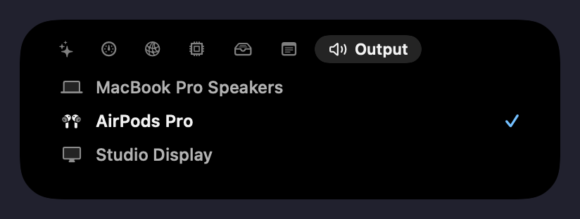
</p>

### Ask

<p align="center">
  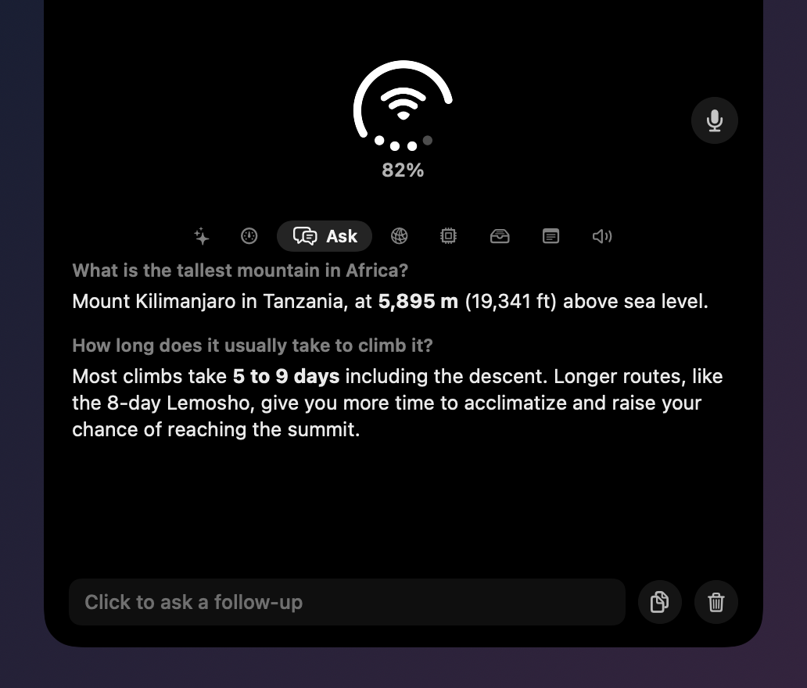
</p>

The Ask tab answers with ChatGPT's models on your **ChatGPT subscription**, with no API key and no API billing. It talks to the Codex that comes with the ChatGPT app, so sign in to Codex in the ChatGPT app once. Answers count toward your Codex usage limits.

The menu beside the field picks the model and speed. It lists every model Codex offers you and defaults to the fast Luna model at low reasoning, where a follow-up starts answering in about a second.

To dictate a question, click the mic beside the field and talk; the words appear as you speak, and a second click stops. Speech is transcribed on your Mac with Apple's on-device recognition, so no audio leaves it. The first time, macOS asks for Microphone and Speech Recognition access.

Each conversation is a bare chat: Codex runs in an empty private folder, read-only, with your MCP servers, plugins and hooks switched off, and the conversation is not saved to Codex's history. Turn the tab off in **Settings → General → Ask AI**.

## Agent alerts

BetterNotch installs small hooks into Claude Code, Codex and Cursor, and shows their events in the notch:

- **Approvals.** Approve or deny a tool request from the notch, or hand it back to the agent's own prompt.
- **Questions.** When an agent asks you a question, the notch shows it with an Open session button. Questions never get an Approve button.
- **Finished turns.** A short summary of what the agent did, with Open session.
- **Browser actions.** The Claude app asks before Claude clicks or types on a new site, and that prompt does not reach hooks. When a browser action has been waiting for 4 seconds, the notch says Claude may need you.
- **No interruptions.** Alerts wait while you are using the opened notch, and every alert has an X to dismiss it.

<p align="center">
  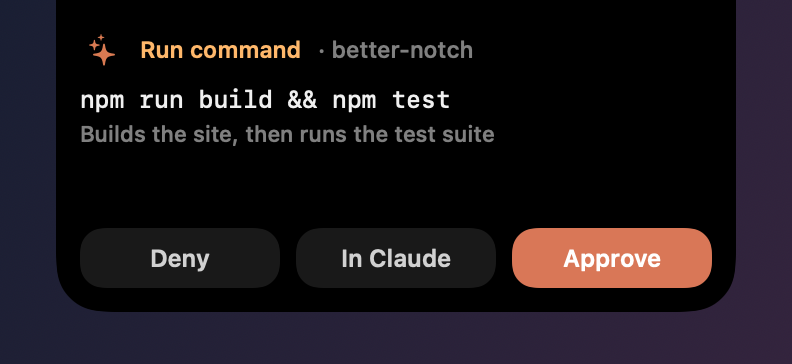
  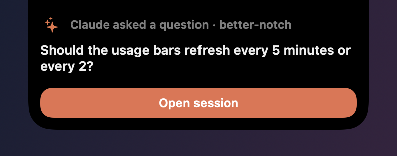
  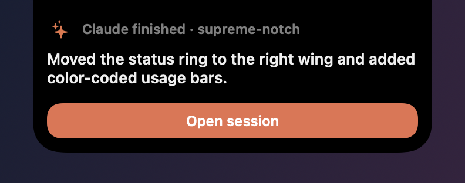
</p>

## Glances

Short notices that slide out of the notch and go away on their own:

- Meeting reminders from your calendars, including Google calendars added through Internet Accounts, with Join and Dismiss buttons and an optional countdown strip.
- Network changes: Wi-Fi connected or lost, no internet, personal hotspot, Ethernet connected or disconnected.
- AirPods battery when they connect, and audio output changes.
- Finished downloads.
- Focus, brightness and volume changes, plus music controls on the lock screen.

## Requirements

- A Mac with a notch, on macOS 14.6 or newer.
- For the usage bars: claude-usage-monitor, a small Rust tool whose source is in `usage-monitor/` and which is bundled inside the app. Enter your keys in **Settings → AI Usage**; they are stored in your Keychain.

## Install

1. Download the latest `BetterNotch-<version>.zip` from [Releases](../../releases).
2. Unzip it and move **BetterNotch.app** to Applications. If you still have Notchly.app, quit it and move it to the Trash first.
3. Open it. The build is signed with a Developer ID and notarized by Apple.

When moving from Notchly, macOS asks once per saved usage key for permission to copy it, and Calendar, Bluetooth, Automation and Downloads access need granting again because the app has a new identity.

Automatic updates are turned off in this fork for now, so install new releases by hand.

## Privacy

Everything runs on your Mac. There is no analytics or telemetry. The only network calls are the ones you turn on: the usage monitor asks Claude and OpenAI for your own usage, the Ask tab sends your questions to OpenAI through Codex when you ask one, and the internet check pings `www.apple.com`. Agent hooks write to a local folder that only this app reads.

## Build from source

```sh
git clone git@github.com:max-hunts/better-notch.git
cd better-notch
open Notchly.xcodeproj
```

A Release build needs the usage monitor copied into the app after export, then the app re-signed:

```sh
cargo build --release --manifest-path usage-monitor/Cargo.toml
cp usage-monitor/target/release/claude-usage-monitor BetterNotch.app/Contents/Helpers/
codesign --force --options runtime --timestamp --sign "Developer ID Application: <you>" BetterNotch.app/Contents/Helpers/claude-usage-monitor
codesign --force --options runtime --timestamp --sign "Developer ID Application: <you>" \
  --preserve-metadata=entitlements,requirements,flags,runtime BetterNotch.app
```

The `scripts` folder has the rest of the workflow, all for a Mac with Xcode:

- `scripts/build-run.sh VERSION BUILD` builds a signed Release, bundles the usage monitor, installs it in Applications and opens it. It is not notarized; use it while iterating.
- `scripts/release.sh VERSION BUILD` does the same, then notarizes and staples it and writes the release zip. It needs a notarytool keychain profile (`NOTARY_PROFILE`, default `max-hunt-notary`).
- `scripts/render-readme-glyphs.sh` redraws the status ring, closed notch and usage color images in `docs/images`.

Both build scripts build the usage monitor from `usage-monitor/` (or wherever `USAGE_MONITOR_DIR` points), so they need Rust's `cargo`. The folder also has the tool's own terminal app and SwiftBar plugin; see `usage-monitor/README.md`.

To check the layout after a change, run `scripts/layout-check.sh`. It shows sample alerts in the real island, saves a picture of each, and fails if the buttons are not 12 pt from the island's edges or the text sits too far above them. It then swipes through the tabs and fails if the island's two edges ever move by different amounts while it resizes.

The README images are drawn by the app's own views with sample data. In a Debug build, run `BetterNotch.app/Contents/MacOS/BetterNotch -renderReadmeImages <folder>` to regenerate the tab and alert images.

## Credits

- [Notchly](https://github.com/Notchly/Notchly), the app this fork is built on (MIT).
- [DuoBar](https://github.com/Mikeli7666/DuoBar) by Mike Li, for the status ring's geometry (MIT).
- [SkyLightWindow](https://github.com/Lakr233/SkyLightWindow) for overlay windows (MIT).
- [Sparkle](https://sparkle-project.org/) for updates.
- [mediaremote-adapter](https://github.com/ejbills/mediaremote-adapter) for Now Playing access.

## License

MIT. See [LICENSE](LICENSE). The original Notchly copyright notice is kept alongside Max Hunt's, as the license requires.
