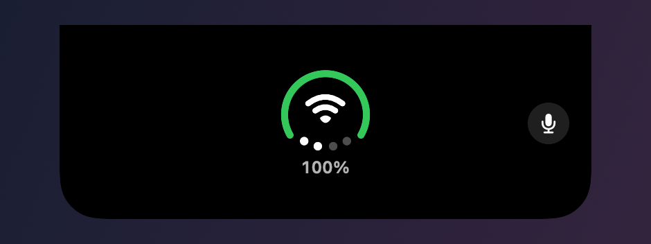

<p align="center">
  
</p>

<h1 align="center">Better Notch</h1>

<p align="center">
  A native macOS app that turns the MacBook notch into a status bar, an agent console and a scratch space.
</p>

<p align="center">
  
  
  
</p>

Better Notch is a fork of [Notchly](https://github.com/Notchly/Notchly) (MIT). The app still builds and installs as **Notchly.app**, with the same bundle ID, so settings carry over.

## At a glance

<p align="center">
  
</p>

The closed notch stays out of the way. The camera sits in the middle, with a small wing on each side:

- **Right wing, the status ring.** One glyph shows three things. The outer arc is your battery level. The center shows your network: Wi-Fi bars, an Ethernet plug, or offline. The four dots along the bottom show output volume.
- **Left wing, usage bars.** One short bar for each subscription limit: Claude's 5-hour, weekly and per-model limits, plus Codex. They refresh every 5 minutes.
- **Muted mic.** A red slashed mic appears next to the camera whenever your microphone is muted.

<p align="center">
  
</p>

The ring turns green while charging, red when the battery is low and yellow in Low Power Mode. Charging color changes the moment you plug in or unplug.

<p align="center">
  
</p>

Claude's bars run cold to hot, from blue through white to red. Codex's run green to red. Any bar at its limit turns purple.

## Opened notch

Click the notch, or just hover over it, to open it.

<p align="center">
  
</p>

The top shows a large status ring with the battery percentage, plus a mic mute button. Below it is a row of tabs. Swipe or click to switch tabs, and the notch resizes to fit each one.

| Tab | What it shows |
|---|---|
| Agents | Your running Claude Code and Codex sessions, what each one is doing right now, and a button that opens the exact session in the Claude app. |
| Usage | Claude and Codex usage bars with reset times. |
| Ports | Local servers listening on your Mac, with the process that owns each port. |
| System | CPU, memory and disk rings, plus a 5-minute network chart (download and upload). |
| Shelf | A drop zone for files. Drag a file toward the notch and it opens itself; drag files back out with their names intact. |
| Note | A quick scratch note that stays between launches. |
| Output | Switch the audio output device. |

## Agent alerts

Better Notch installs small hooks into Claude Code, Codex and Cursor, and shows their events in the notch:

- **Approvals.** Approve or deny a tool request from the notch, or hand it back to the agent's own prompt.
- **Questions.** When an agent asks you a question, the notch shows it with an Open session button. Questions never get an Approve button.
- **Finished turns.** A short summary of what the agent did, with Open session.
- **No interruptions.** Alerts wait while you are using the opened notch, and every alert has an X to dismiss it.

## Glances

Short notices that slide out of the notch and go away on their own:

- Meeting reminders from your calendars, including Google calendars added through Internet Accounts, with Join and Dismiss buttons and an optional countdown strip.
- Network changes: Wi-Fi connected or lost, no internet, personal hotspot, Ethernet connected or disconnected.
- AirPods battery when they connect, and audio output changes.
- Finished downloads.
- Focus, brightness and volume changes, plus music controls on the lock screen.

## Requirements

- A Mac with a notch, on macOS 14.6 or newer.
- For the usage bars: [claude-usage-monitor](https://github.com/max-hunts/claude-usage-monitor), which is bundled inside the app. Enter your keys in **Settings → AI Usage**; they are stored in your Keychain.

## Install

1. Download the latest `Notchly-<version>.zip` from [Releases](../../releases).
2. Unzip it and move **Notchly.app** to Applications.
3. Open it. The build is signed with a Developer ID and notarized by Apple.

Automatic updates are turned off in this fork for now, so install new releases by hand.

## Privacy

Everything runs on your Mac. There is no analytics or telemetry. The only network calls are the ones you turn on: the usage monitor asks Claude and OpenAI for your own usage, and the internet check pings `www.apple.com`. Agent hooks write to a local folder that only this app reads.

## Build from source

```sh
git clone git@github.com:max-hunts/better-notch.git
cd better-notch
open Notchly.xcodeproj
```

A Release build needs the usage monitor copied into the app after export, then the app re-signed:

```sh
cargo build --release --manifest-path ../claude-usage-monitor/Cargo.toml
cp ../claude-usage-monitor/target/release/claude-usage-monitor Notchly.app/Contents/Helpers/
codesign --force --options runtime --timestamp --sign "Developer ID Application: <you>" Notchly.app/Contents/Helpers/claude-usage-monitor
codesign --force --options runtime --timestamp --sign "Developer ID Application: <you>" \
  --preserve-metadata=entitlements,requirements,flags,runtime Notchly.app
```

## Credits

- [Notchly](https://github.com/Notchly/Notchly), the app this fork is built on (MIT).
- [DuoBar](https://github.com/Mikeli7666/DuoBar) by Mike Li, for the status ring's geometry (MIT).
- [SkyLightWindow](https://github.com/Lakr233/SkyLightWindow) for overlay windows (MIT).
- [Sparkle](https://sparkle-project.org/) for updates.
- [mediaremote-adapter](https://github.com/ejbills/mediaremote-adapter) for Now Playing access.

## License

MIT. See [LICENSE](LICENSE). The original Notchly copyright notice is kept as the license requires.
